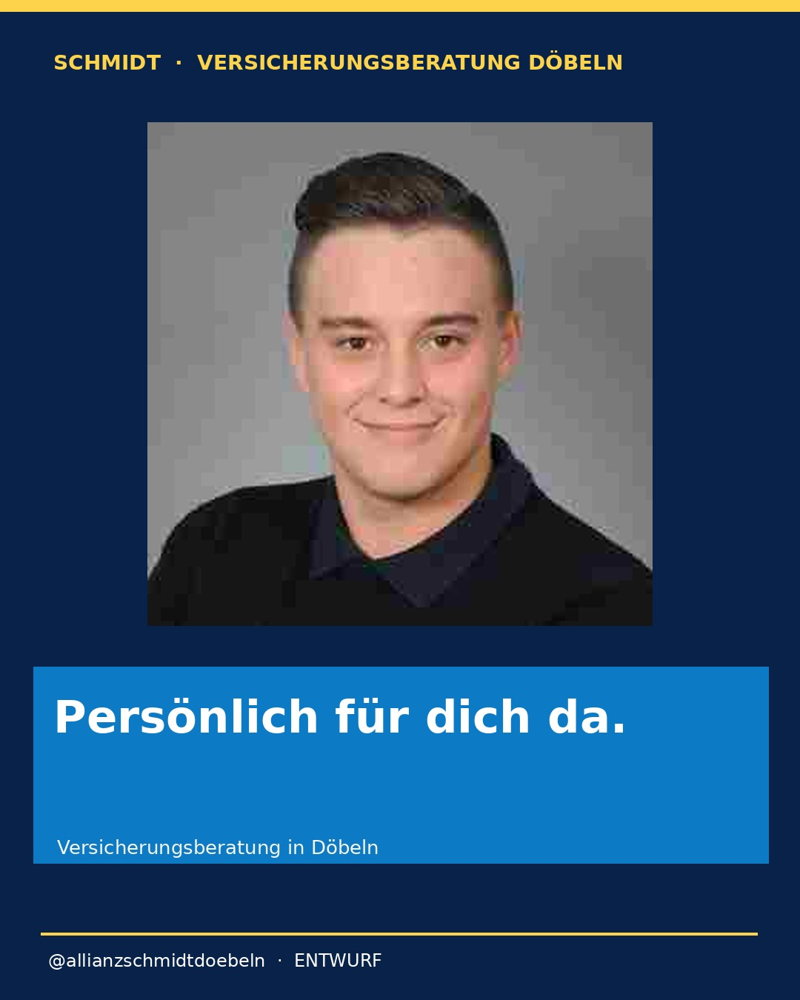
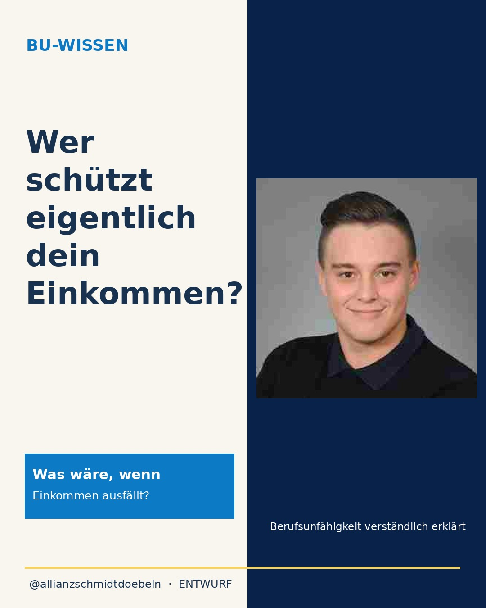
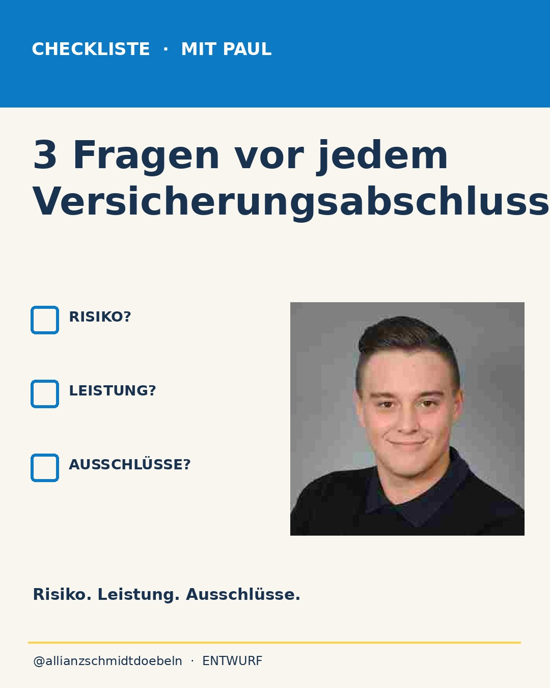
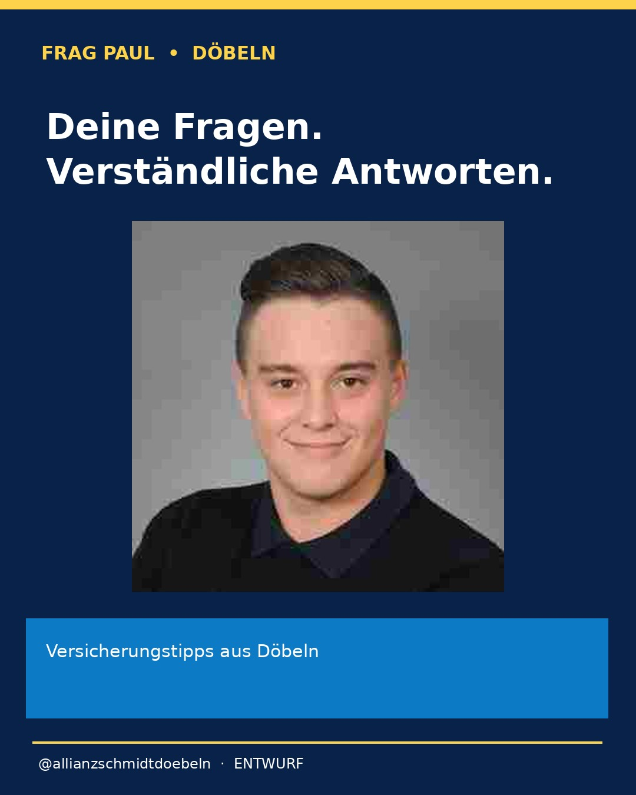
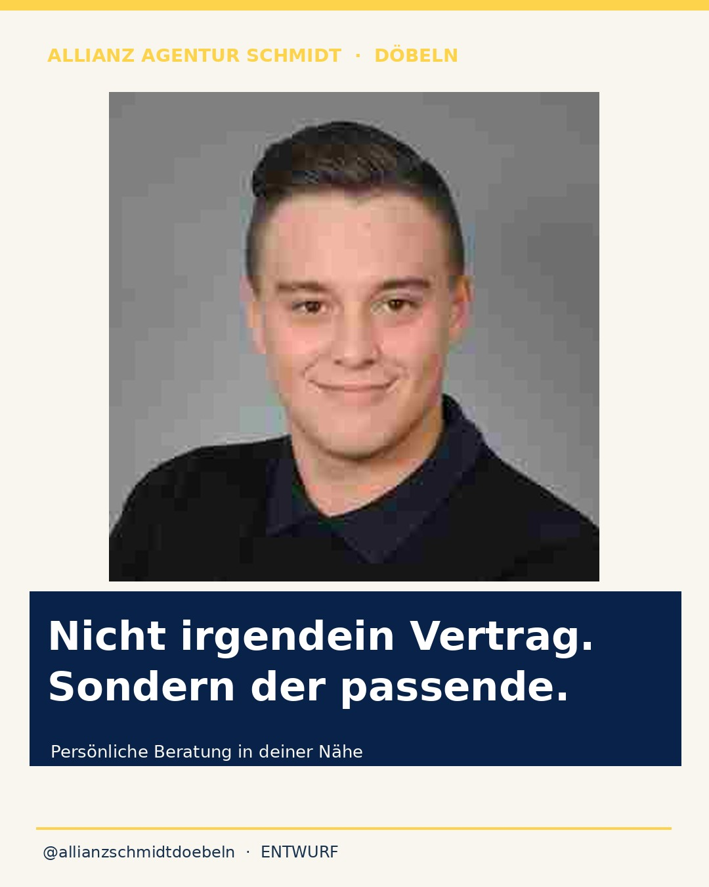

# Persönliche Instagram-Beitragsentwürfe – ausschließlich Paul

**Konto:** [@allianzschmidtdoebeln](https://www.instagram.com/allianzschmidtdoebeln/)

**Status: Entwürfe, nicht zur Veröffentlichung freigegeben.**

Die Grafiken benutzen ausschließlich das vom Nutzer am 04.11.2026 hochgeladene persönliche Porträt von Paul Schmidt. Es wurde eine **komprimierte Vorschaukopie mit 300 × 299 Pixeln** direkt in GitHub unter [assets/portrait/paul_schmidt.jpg](assets/portrait/paul_schmidt.jpg) abgelegt, um die GitHub-Automatisierung auszuführen. Für professionelle Veröffentlichungen in voller Bildqualität sollte später die Originaldatei mit 835 × 833 Pixeln verwendet werden. Andere Personenbilder sind im Projekt gesperrt.

## 1. Persönlich für dich da.

**Postidee:** Persönliche Beratung aus Döbeln statt nur anonymer Online-Formulare.

## 2. Wer schützt eigentlich dein Einkommen?

**Postidee:** Ein kurzer, differenzierter Einstieg in den Berufsunfähigkeitsschutz ohne pauschale Leistungsversprechen.

## 3. Drei Fragen vor jedem Versicherungsabschluss

**Postidee:** Risiko, konkrete Leistungen und Ausschlüsse prüfen.

## 4. Deine Fragen. Verständliche Antworten.

**Postidee:** Persönliches Format für häufige Fragen aus der Versicherungsberatung.

## 5. Nicht irgendein Vertrag. Sondern der passende.

**Postidee:** Individueller Versicherungscheck statt pauschaler Abschluss.

---

**Veröffentlichung:** Keine automatische Einplanung über Buffer; vor Veröffentlichung fachliche Prüfung, Allianz-Markenfreigabe und ausdrückliche Freigabe erforderlich. Nur das hochgeladene Nutzerporträt darf für Personenmotive verwendet werden. Bei neuen Reels ohne Originalvideo dürfen keine künstlichen Talking-Head- oder Lippensynchronisationsvideos erstellt werden.
