# Vorschau aller 30 Instagram-Beiträge

**Instagram:** [@allianzschmidtdoebeln](https://www.instagram.com/allianzschmidtdoebeln/)  
**Status:** Entwürfe – keiner der Beiträge ist zur Veröffentlichung freigegeben.  
**Stand:** 03.11.2026

Die Bilder und Texte stammen direkt aus der aktuellen Datei `posts.json`. Die Entwürfe sind noch **nicht** auf Instagram veröffentlicht. Bitte Produktangaben, Werbevorgaben, Corporate Design und Pflichtangaben der Agentur vor Freigabe prüfen.

## Übersicht

[01 · Haftpflicht](#beitrag-01) · [02 · Berufsunfähigkeit](#beitrag-02) · [03 · Kfz](#beitrag-03) · [04 · Hausrat](#beitrag-04) · [05 · Wohngebäude](#beitrag-05) · [06 · Zahnzusatz](#beitrag-06) · [07 · Rechtsschutz](#beitrag-07) · [08 · Unfall](#beitrag-08) · [09 · Schüler-BU](#beitrag-09) · [10 · Familie](#beitrag-10) · [11 · Mieter](#beitrag-11) · [12 · Eigenheim](#beitrag-12) · [13 · Erste Wohnung](#beitrag-13) · [14 · Kfz](#beitrag-14) · [15 · Selbstbeteiligung](#beitrag-15) · [16 · Grundlagen](#beitrag-16) · [17 · Berufsunfähigkeit](#beitrag-17) · [18 · Haftpflicht](#beitrag-18) · [19 · Fahrrad](#beitrag-19) · [20 · Elementarschäden](#beitrag-20) · [21 · Wartezeit](#beitrag-21) · [22 · Unfall](#beitrag-22) · [23 · Beratung](#beitrag-23) · [24 · Versicherungsmythen](#beitrag-24) · [25 · Berufsunfähigkeit](#beitrag-25) · [26 · Fahranfänger](#beitrag-26) · [27 · Wohngebäude](#beitrag-27) · [28 · Zahnzusatz](#beitrag-28) · [29 · Familie](#beitrag-29) · [30 · Versicherungscheck](#beitrag-30)

---

## Beitrag 01

**Thema:** Haftpflicht · **Status:** Entwurf / nicht freigegeben

**Instagram-Bild:** Wer bezahlt, wenn du aus Versehen etwas beschädigst?  
*Nicht jeder Schaden ist automatisch versichert.*

**Vorgesehene Caption:**

> Wer bezahlt, wenn du aus Versehen etwas beschädigst?
>
> Eine private Haftpflichtversicherung kann berechtigte Schadenersatzforderungen abdecken und unberechtigte Forderungen abwehren. Ob das in deinem Fall gilt, hängt von den Bedingungen ab.
>
> 💬 Kennst du deine vereinbarte Versicherungssumme?
>
> Allgemeine Information, keine individuelle Leistungszusage. Maßgeblich sind Vertrag und Bedingungen.
>
> #Versicherung #Döbeln #Mittelsachsen #Versicherungswissen

[Zur Übersicht](#übersicht)

---

## Beitrag 02

**Thema:** Berufsunfähigkeit · **Status:** Entwurf / nicht freigegeben

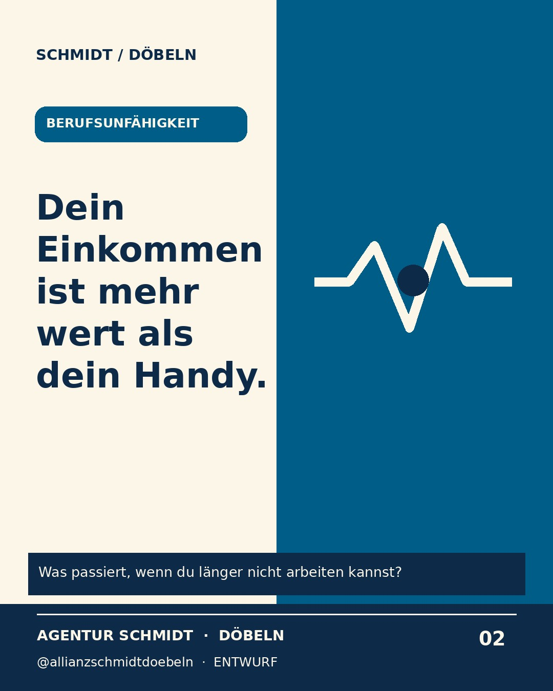

**Instagram-Bild:** Dein Einkommen ist mehr wert als dein Handy.  
*Was passiert, wenn du länger nicht arbeiten kannst?*

**Vorgesehene Caption:**

> Dein Einkommen ist mehr wert als dein Handy.
>
> Die Berufsunfähigkeitsversicherung kann eine vereinbarte Rente zahlen, wenn die vertraglichen Voraussetzungen erfüllt sind. Wie hoch der Schutz sein sollte, hängt unter anderem vom Einkommen ab.
>
> 💬 Hast du deine monatlichen Fixkosten einmal zusammengerechnet?
>
> Allgemeine Information, keine individuelle Leistungszusage. Maßgeblich sind Vertrag und Bedingungen.
>
> #Versicherung #Döbeln #Mittelsachsen #Versicherungswissen

[Zur Übersicht](#übersicht)

---

## Beitrag 03

**Thema:** Kfz · **Status:** Entwurf / nicht freigegeben

**Instagram-Bild:** Nur Haftpflicht oder auch Kasko?  
*Der Unterschied ist größer als der Preis.*

**Vorgesehene Caption:**

> Nur Haftpflicht oder auch Kasko?
>
> Die Kfz-Haftpflicht schützt vor berechtigten Ansprüchen anderer. Teil- und Vollkasko betreffen Schäden am eigenen Fahrzeug – je nach gewähltem Versicherungsschutz.
>
> 💬 Wie alt ist dein Fahrzeug?
>
> Allgemeine Information, keine individuelle Leistungszusage. Maßgeblich sind Vertrag und Bedingungen.
>
> #Versicherung #Döbeln #Mittelsachsen #Versicherungswissen

[Zur Übersicht](#übersicht)

---

## Beitrag 04

**Thema:** Hausrat · **Status:** Entwurf / nicht freigegeben

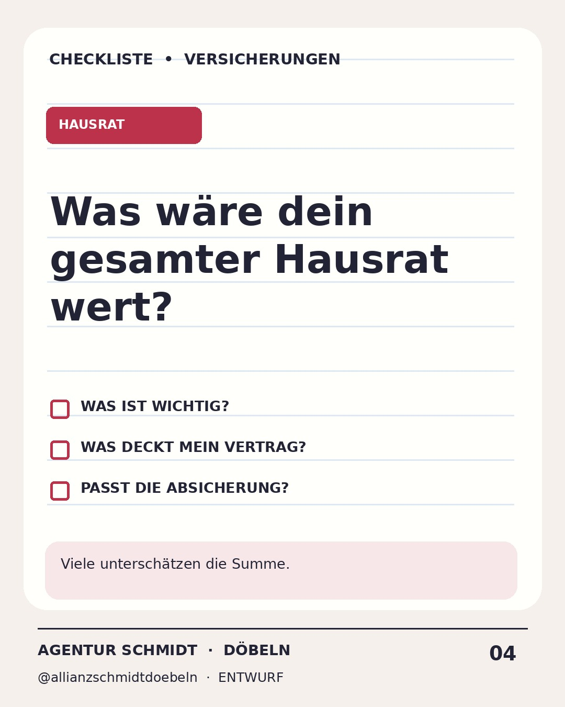

**Instagram-Bild:** Was wäre dein gesamter Hausrat wert?  
*Viele unterschätzen die Summe.*

**Vorgesehene Caption:**

> Was wäre dein gesamter Hausrat wert?
>
> Möbel, Technik, Kleidung und vieles mehr ergeben zusammen einen hohen Wiederbeschaffungswert. Eine Hausratversicherung kann bei vereinbarten Gefahren helfen.
>
> 💬 Wie hoch würdest du deinen Hausrat einschätzen?
>
> Allgemeine Information, keine individuelle Leistungszusage. Maßgeblich sind Vertrag und Bedingungen.
>
> #Versicherung #Döbeln #Mittelsachsen #Versicherungswissen

[Zur Übersicht](#übersicht)

---

## Beitrag 05

**Thema:** Wohngebäude · **Status:** Entwurf / nicht freigegeben

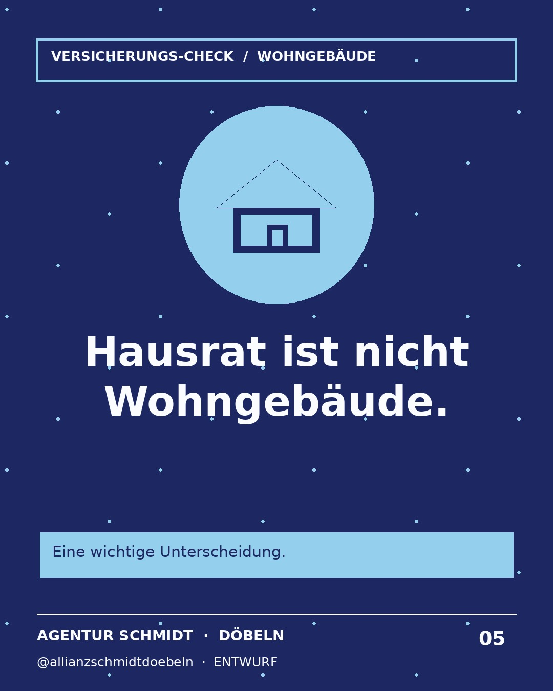

**Instagram-Bild:** Hausrat ist nicht Wohngebäude.  
*Eine wichtige Unterscheidung.*

**Vorgesehene Caption:**

> Hausrat ist nicht Wohngebäude.
>
> Vereinfacht gesagt schützt eine Wohngebäudeversicherung das Gebäude, während die Hausratversicherung bewegliche Sachen absichern kann. Bei Einbauten zählt die genaue Vertragsdefinition.
>
> 💬 Kennst du den Unterschied?
>
> Allgemeine Information, keine individuelle Leistungszusage. Maßgeblich sind Vertrag und Bedingungen.
>
> #Versicherung #Döbeln #Mittelsachsen #Versicherungswissen

[Zur Übersicht](#übersicht)

---

## Beitrag 06

**Thema:** Zahnzusatz · **Status:** Entwurf / nicht freigegeben

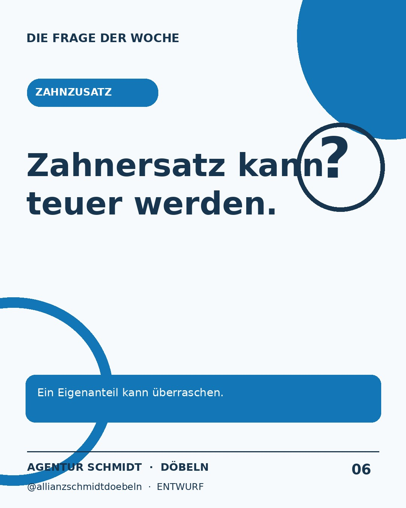

**Instagram-Bild:** Zahnersatz kann teuer werden.  
*Ein Eigenanteil kann überraschen.*

**Vorgesehene Caption:**

> Zahnersatz kann teuer werden.
>
> Eine Zahnzusatzversicherung kann je nach Tarif Eigenanteile reduzieren. Wichtig sind Leistungsgrenzen, Zahnstaffeln und der Umgang mit bereits angeratenen Behandlungen.
>
> 💬 Welche Leistungen wären dir besonders wichtig?
>
> Allgemeine Information, keine individuelle Leistungszusage. Maßgeblich sind Vertrag und Bedingungen.
>
> #Versicherung #Döbeln #Mittelsachsen #Versicherungswissen

[Zur Übersicht](#übersicht)

---

## Beitrag 07

**Thema:** Rechtsschutz · **Status:** Entwurf / nicht freigegeben

**Instagram-Bild:** Recht haben ist nicht immer günstig.  
*Welche Kosten entstehen im Streitfall?*

**Vorgesehene Caption:**

> Recht haben ist nicht immer günstig.
>
> Rechtsschutz kann im vereinbarten Umfang Kosten für Anwälte oder Gerichte übernehmen. Nicht jeder Streit und nicht jeder Rechtsbereich ist automatisch eingeschlossen.
>
> 💬 Welche Bereiche würdest du absichern wollen?
>
> Allgemeine Information, keine individuelle Leistungszusage. Maßgeblich sind Vertrag und Bedingungen.
>
> #Versicherung #Döbeln #Mittelsachsen #Versicherungswissen

[Zur Übersicht](#übersicht)

---

## Beitrag 08

**Thema:** Unfall · **Status:** Entwurf / nicht freigegeben

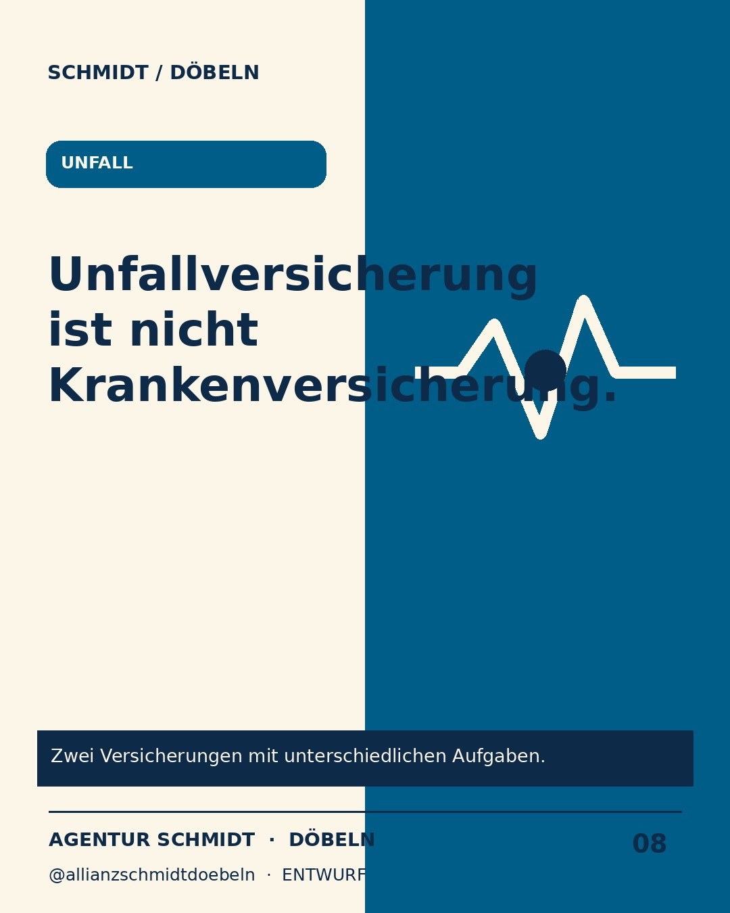

**Instagram-Bild:** Unfallversicherung ist nicht Krankenversicherung.  
*Zwei Versicherungen mit unterschiedlichen Aufgaben.*

**Vorgesehene Caption:**

> Unfallversicherung ist nicht Krankenversicherung.
>
> Eine Krankenversicherung deckt medizinische Leistungen im vereinbarten oder gesetzlichen Umfang. Eine private Unfallversicherung kann bei dauerhafter unfallbedingter Invalidität Leistungen erbringen.
>
> 💬 Weißt du, welche Unfälle dein Vertrag einschließt?
>
> Allgemeine Information, keine individuelle Leistungszusage. Maßgeblich sind Vertrag und Bedingungen.
>
> #Versicherung #Döbeln #Mittelsachsen #Versicherungswissen

[Zur Übersicht](#übersicht)

---

## Beitrag 09

**Thema:** Schüler-BU · **Status:** Entwurf / nicht freigegeben

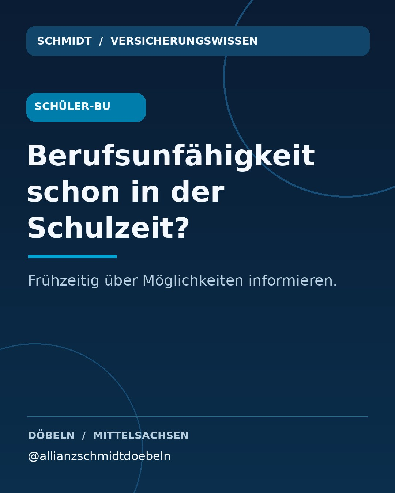

**Instagram-Bild:** Berufsunfähigkeit schon in der Schulzeit?  
*Frühzeitig über Möglichkeiten informieren.*

**Vorgesehene Caption:**

> Berufsunfähigkeit schon in der Schulzeit?
>
> Für Schülerinnen und Schüler gibt es besondere Absicherungskonzepte. Entscheidend sind Tarif, Gesundheitsprüfung und die vertraglichen Bedingungen.
>
> 💬 Soll ich erklären, worauf Eltern achten sollten?
>
> Allgemeine Information, keine individuelle Leistungszusage. Maßgeblich sind Vertrag und Bedingungen.
>
> #Versicherung #Döbeln #Mittelsachsen #Versicherungswissen

[Zur Übersicht](#übersicht)

---

## Beitrag 10

**Thema:** Familie · **Status:** Entwurf / nicht freigegeben

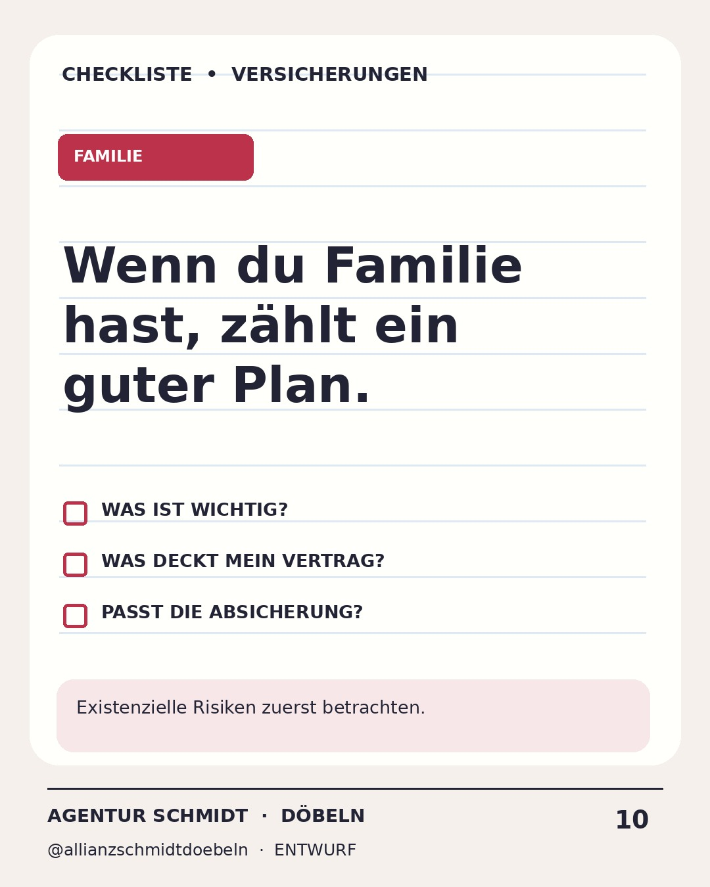

**Instagram-Bild:** Wenn du Familie hast, zählt ein guter Plan.  
*Existenzielle Risiken zuerst betrachten.*

**Vorgesehene Caption:**

> Wenn du Familie hast, zählt ein guter Plan.
>
> Mit Kindern oder anderen finanziell abhängigen Personen ändern sich oft die Absicherungsbedürfnisse. Einkommen und Hinterbliebenenschutz verdienen besondere Aufmerksamkeit.
>
> 💬 Was wäre für deine Familie finanziell am wichtigsten?
>
> Allgemeine Information, keine individuelle Leistungszusage. Maßgeblich sind Vertrag und Bedingungen.
>
> #Versicherung #Döbeln #Mittelsachsen #Versicherungswissen

[Zur Übersicht](#übersicht)

---

## Beitrag 11

**Thema:** Mieter · **Status:** Entwurf / nicht freigegeben

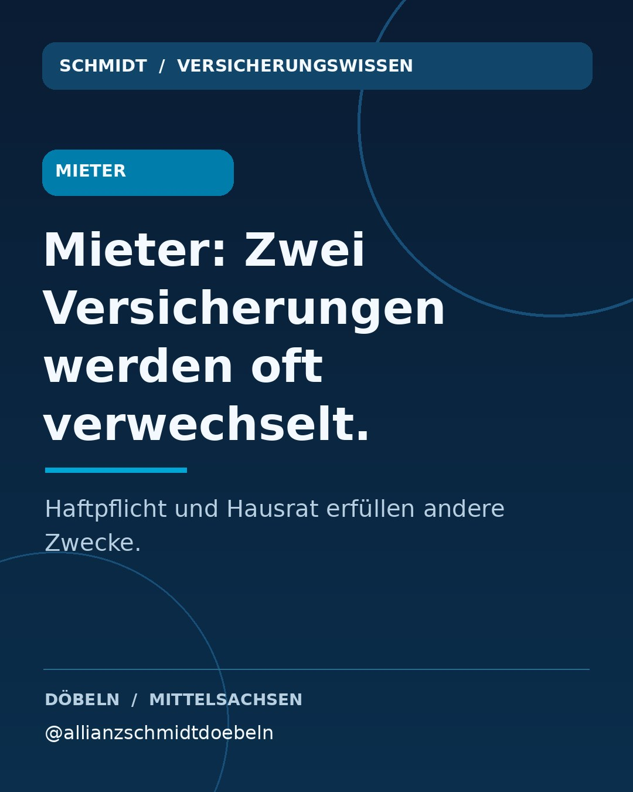

**Instagram-Bild:** Mieter: Zwei Versicherungen werden oft verwechselt.  
*Haftpflicht und Hausrat erfüllen andere Zwecke.*

**Vorgesehene Caption:**

> Mieter: Zwei Versicherungen werden oft verwechselt.
>
> Die Haftpflicht kann bei Schäden helfen, für die du anderen gegenüber haftest. Hausrat betrifft versicherte Schäden an deinen eigenen beweglichen Sachen.
>
> 💬 Hast du beides schon einmal verglichen?
>
> Allgemeine Information, keine individuelle Leistungszusage. Maßgeblich sind Vertrag und Bedingungen.
>
> #Versicherung #Döbeln #Mittelsachsen #Versicherungswissen

[Zur Übersicht](#übersicht)

---

## Beitrag 12

**Thema:** Eigenheim · **Status:** Entwurf / nicht freigegeben

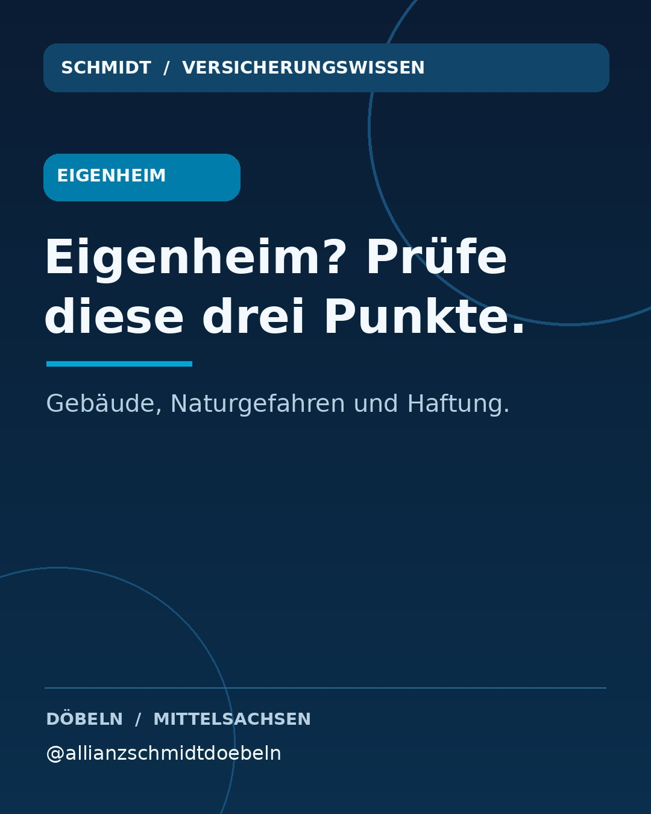

**Instagram-Bild:** Eigenheim? Prüfe diese drei Punkte.  
*Gebäude, Naturgefahren und Haftung.*

**Vorgesehene Caption:**

> Eigenheim? Prüfe diese drei Punkte.
>
> Bei Wohneigentum lohnt sich der Blick auf Wohngebäude, Elementarschäden und mögliche Haftungsrisiken. Welche Bausteine sinnvoll sind, hängt vom Objekt ab.
>
> 💬 Wann wurde dein Gebäudeschutz zuletzt geprüft?
>
> Allgemeine Information, keine individuelle Leistungszusage. Maßgeblich sind Vertrag und Bedingungen.
>
> #Versicherung #Döbeln #Mittelsachsen #Versicherungswissen

[Zur Übersicht](#übersicht)

---

## Beitrag 13

**Thema:** Erste Wohnung · **Status:** Entwurf / nicht freigegeben

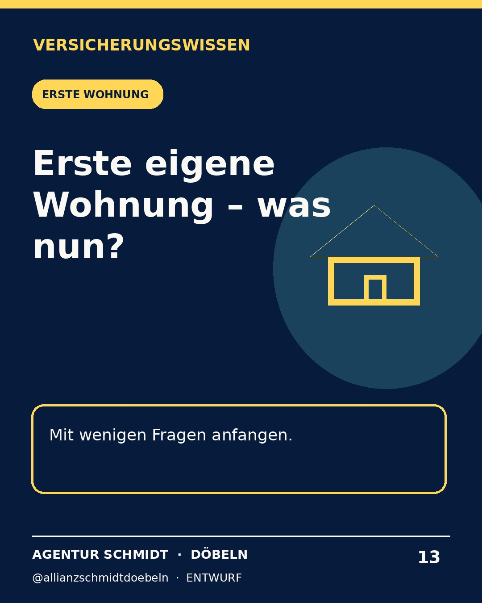

**Instagram-Bild:** Erste eigene Wohnung – was nun?  
*Mit wenigen Fragen anfangen.*

**Vorgesehene Caption:**

> Erste eigene Wohnung – was nun?
>
> Der Umzug in die erste Wohnung ist ein guter Anlass, den eigenen Hausratwert und mögliche Haftungsrisiken zu prüfen.
>
> 💬 Bist du gerade umgezogen?
>
> Allgemeine Information, keine individuelle Leistungszusage. Maßgeblich sind Vertrag und Bedingungen.
>
> #Versicherung #Döbeln #Mittelsachsen #Versicherungswissen

[Zur Übersicht](#übersicht)

---

## Beitrag 14

**Thema:** Kfz · **Status:** Entwurf / nicht freigegeben

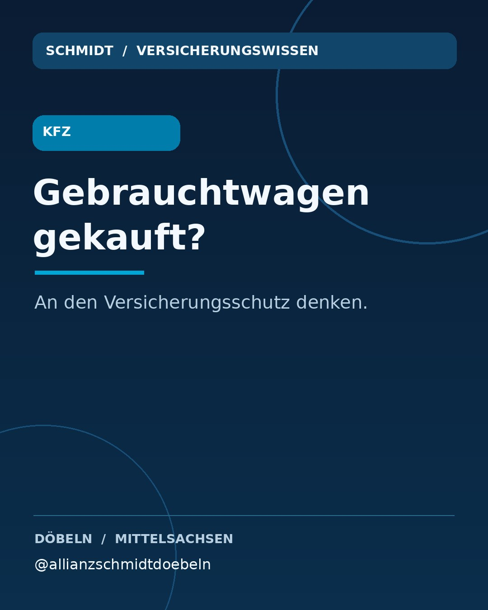

**Instagram-Bild:** Gebrauchtwagen gekauft?  
*An den Versicherungsschutz denken.*

**Vorgesehene Caption:**

> Gebrauchtwagen gekauft?
>
> Beim Fahrzeugwechsel sollte rechtzeitig geklärt werden, welcher Versicherungsschutz zum Wert des Autos passt und ab wann er gelten soll.
>
> 💬 Kaufst du eher neu oder gebraucht?
>
> Allgemeine Information, keine individuelle Leistungszusage. Maßgeblich sind Vertrag und Bedingungen.
>
> #Versicherung #Döbeln #Mittelsachsen #Versicherungswissen

[Zur Übersicht](#übersicht)

---

## Beitrag 15

**Thema:** Selbstbeteiligung · **Status:** Entwurf / nicht freigegeben

**Instagram-Bild:** Was bedeutet eigentlich Selbstbeteiligung?  
*Nicht nur auf den Beitrag achten.*

**Vorgesehene Caption:**

> Was bedeutet eigentlich Selbstbeteiligung?
>
> Eine Selbstbeteiligung bedeutet, dass du einen vereinbarten Teil eines versicherten Schadens selbst trägst. Im Gegenzug kann der Beitrag niedriger sein.
>
> 💬 Wäre dir ein niedriger Beitrag oder eine niedrige Selbstbeteiligung wichtiger?
>
> Allgemeine Information, keine individuelle Leistungszusage. Maßgeblich sind Vertrag und Bedingungen.
>
> #Versicherung #Döbeln #Mittelsachsen #Versicherungswissen

[Zur Übersicht](#übersicht)

---

## Beitrag 16

**Thema:** Grundlagen · **Status:** Entwurf / nicht freigegeben

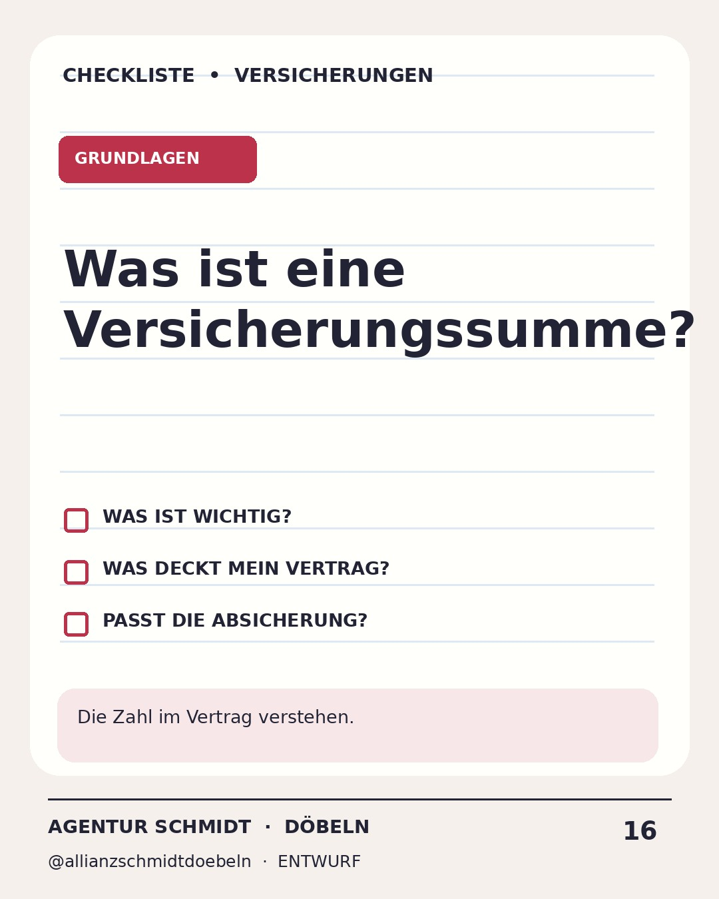

**Instagram-Bild:** Was ist eine Versicherungssumme?  
*Die Zahl im Vertrag verstehen.*

**Vorgesehene Caption:**

> Was ist eine Versicherungssumme?
>
> Die Versicherungssumme beschreibt häufig die vereinbarte Obergrenze eines Schutzes. Bei manchen Produkten gelten andere Leistungsregeln; die genaue Definition steht in den Bedingungen.
>
> 💬 Wann hast du deine Summen zuletzt geprüft?
>
> Allgemeine Information, keine individuelle Leistungszusage. Maßgeblich sind Vertrag und Bedingungen.
>
> #Versicherung #Döbeln #Mittelsachsen #Versicherungswissen

[Zur Übersicht](#übersicht)

---

## Beitrag 17

**Thema:** Berufsunfähigkeit · **Status:** Entwurf / nicht freigegeben

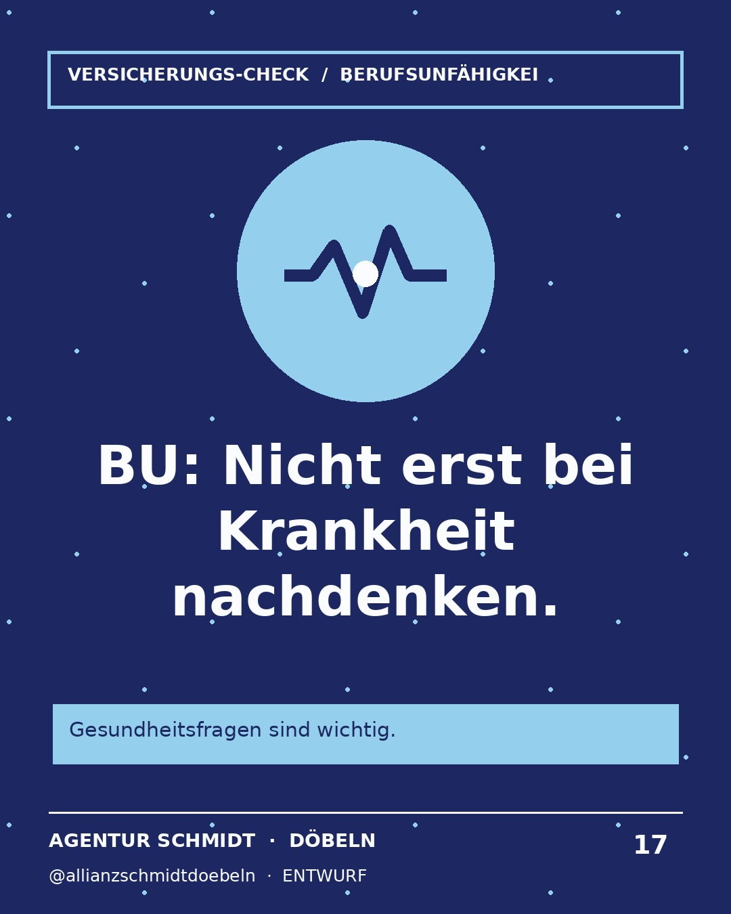

**Instagram-Bild:** BU: Nicht erst bei Krankheit nachdenken.  
*Gesundheitsfragen sind wichtig.*

**Vorgesehene Caption:**

> BU: Nicht erst bei Krankheit nachdenken.
>
> Bei einem BU-Antrag spielen Gesundheitsangaben und individuelle Risikoprüfung eine wichtige Rolle. Frühzeitig informieren kann helfen, Optionen sorgfältig zu prüfen.
>
> 💬 Kennst du die wesentlichen Fragen beim Antrag?
>
> Allgemeine Information, keine individuelle Leistungszusage. Maßgeblich sind Vertrag und Bedingungen.
>
> #Versicherung #Döbeln #Mittelsachsen #Versicherungswissen

[Zur Übersicht](#übersicht)

---

## Beitrag 18

**Thema:** Haftpflicht · **Status:** Entwurf / nicht freigegeben

**Instagram-Bild:** Schlüssel verloren – und jetzt?  
*Nicht jeder Schlüssel ist gleich abgesichert.*

**Vorgesehene Caption:**

> Schlüssel verloren – und jetzt?
>
> Ob ein verlorener fremder Schlüssel und mögliche Folgekosten versichert sind, hängt vom Haftpflichtvertrag und seinen Einschlüssen ab.
>
> 💬 Weißt du, ob Schlüsselverlust in deinem Vertrag steht?
>
> Allgemeine Information, keine individuelle Leistungszusage. Maßgeblich sind Vertrag und Bedingungen.
>
> #Versicherung #Döbeln #Mittelsachsen #Versicherungswissen

[Zur Übersicht](#übersicht)

---

## Beitrag 19

**Thema:** Fahrrad · **Status:** Entwurf / nicht freigegeben

**Instagram-Bild:** Fahrraddiebstahl ist nicht überall gleich versichert.  
*Auf Ort und Umfang achten.*

**Vorgesehene Caption:**

> Fahrraddiebstahl ist nicht überall gleich versichert.
>
> Hausrat- und spezielle Fahrradversicherungen können sich deutlich unterscheiden. Relevant sind etwa Versicherungsort, Sicherung und Summen.
>
> 💬 Wie sicherst du dein Fahrrad ab?
>
> Allgemeine Information, keine individuelle Leistungszusage. Maßgeblich sind Vertrag und Bedingungen.
>
> #Versicherung #Döbeln #Mittelsachsen #Versicherungswissen

[Zur Übersicht](#übersicht)

---

## Beitrag 20

**Thema:** Elementarschäden · **Status:** Entwurf / nicht freigegeben

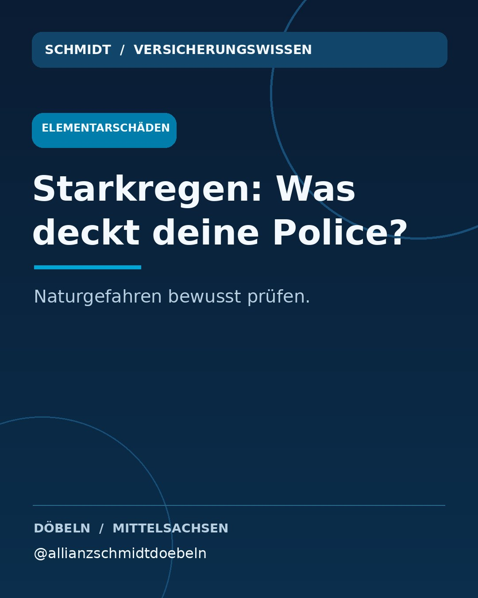

**Instagram-Bild:** Starkregen: Was deckt deine Police?  
*Naturgefahren bewusst prüfen.*

**Vorgesehene Caption:**

> Starkregen: Was deckt deine Police?
>
> Überschwemmung oder Rückstau können besondere Elementarbausteine erfordern. Die Deckung hängt vom Vertrag und von definierten Voraussetzungen ab.
>
> 💬 Ist Elementarschutz bei dir vereinbart?
>
> Allgemeine Information, keine individuelle Leistungszusage. Maßgeblich sind Vertrag und Bedingungen.
>
> #Versicherung #Döbeln #Mittelsachsen #Versicherungswissen

[Zur Übersicht](#übersicht)

---

## Beitrag 21

**Thema:** Wartezeit · **Status:** Entwurf / nicht freigegeben

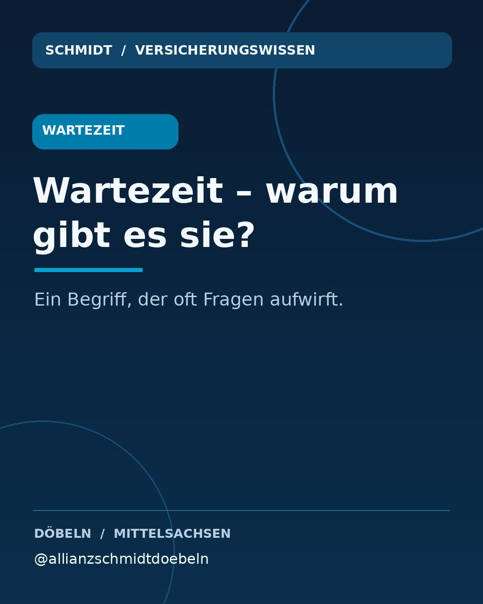

**Instagram-Bild:** Wartezeit – warum gibt es sie?  
*Ein Begriff, der oft Fragen aufwirft.*

**Vorgesehene Caption:**

> Wartezeit – warum gibt es sie?
>
> Manche Tarife sehen Wartezeiten vor, bevor bestimmte Leistungen beansprucht werden können. Andere Tarife verzichten teilweise darauf.
>
> 💬 Prüfst du Wartezeiten vor dem Abschluss?
>
> Allgemeine Information, keine individuelle Leistungszusage. Maßgeblich sind Vertrag und Bedingungen.
>
> #Versicherung #Döbeln #Mittelsachsen #Versicherungswissen

[Zur Übersicht](#übersicht)

---

## Beitrag 22

**Thema:** Unfall · **Status:** Entwurf / nicht freigegeben

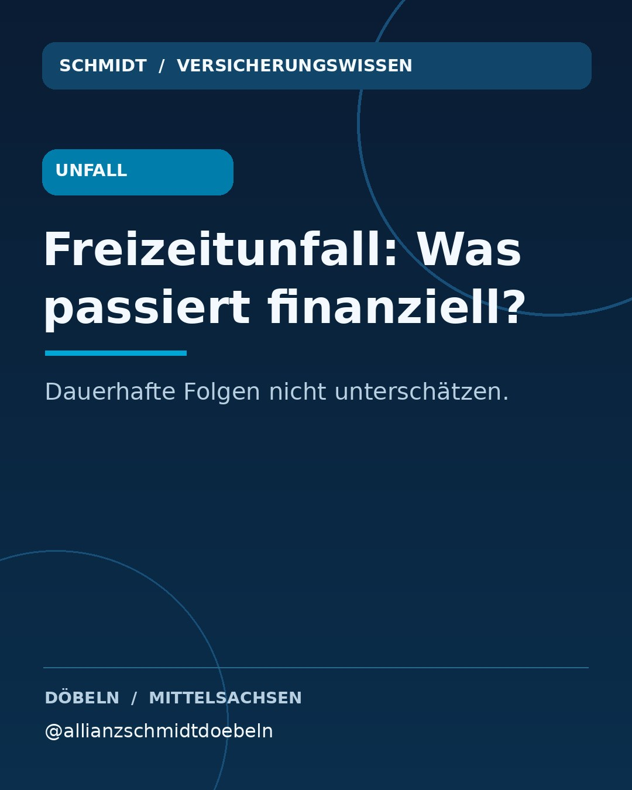

**Instagram-Bild:** Freizeitunfall: Was passiert finanziell?  
*Dauerhafte Folgen nicht unterschätzen.*

**Vorgesehene Caption:**

> Freizeitunfall: Was passiert finanziell?
>
> Ein Unfall in der Freizeit kann finanzielle Auswirkungen haben. Eine private Unfallversicherung kann je nach Vertrag bei dauerhafter Invalidität unterstützen.
>
> 💬 Welche Absicherung hast du für Freizeitunfälle?
>
> Allgemeine Information, keine individuelle Leistungszusage. Maßgeblich sind Vertrag und Bedingungen.
>
> #Versicherung #Döbeln #Mittelsachsen #Versicherungswissen

[Zur Übersicht](#übersicht)

---

## Beitrag 23

**Thema:** Beratung · **Status:** Entwurf / nicht freigegeben

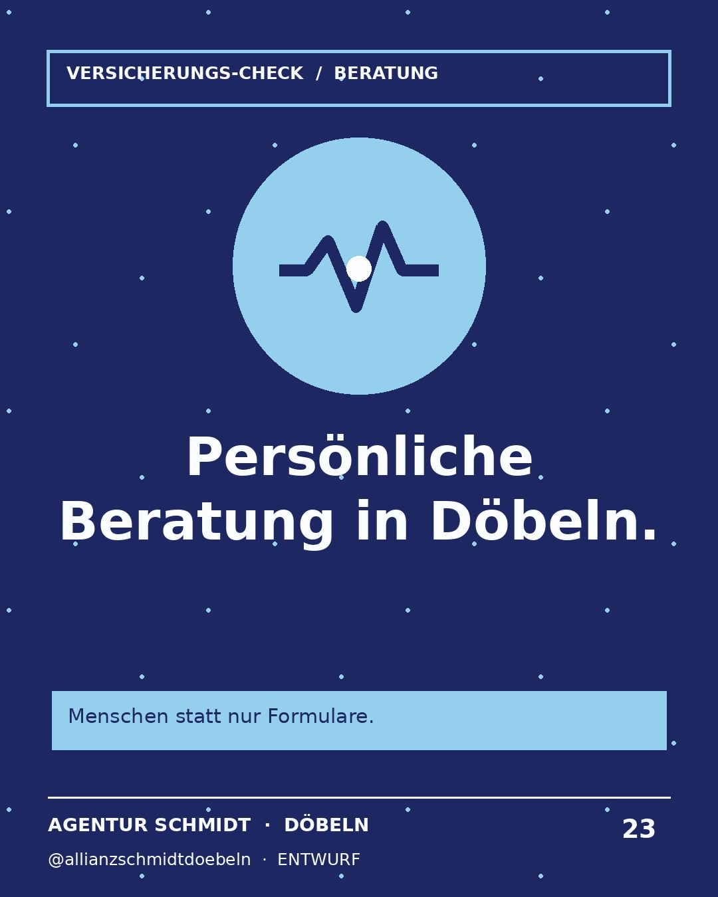

**Instagram-Bild:** Persönliche Beratung in Döbeln.  
*Menschen statt nur Formulare.*

**Vorgesehene Caption:**

> Persönliche Beratung in Döbeln.
>
> Versicherungsschutz sollte zu deiner tatsächlichen Lebenssituation passen. In unserer Agentur in Döbeln sprechen wir über Ziele, Risiken und bestehende Verträge.
>
> 💬 Welches Versicherungsthema möchtest du verständlich erklärt bekommen?
>
> Allgemeine Information, keine individuelle Leistungszusage. Maßgeblich sind Vertrag und Bedingungen.
>
> #Versicherung #Döbeln #Mittelsachsen #Versicherungswissen

[Zur Übersicht](#übersicht)

---

## Beitrag 24

**Thema:** Versicherungsmythen · **Status:** Entwurf / nicht freigegeben

**Instagram-Bild:** Mythos: Viel versichert heißt gut versichert.  
*Wichtiger als die Anzahl ist der Bedarf.*

**Vorgesehene Caption:**

> Mythos: Viel versichert heißt gut versichert.
>
> Viele Policen sind nicht automatisch besser. Entscheidend sind passende Leistungen, sinnvolle Summen und ein abgestimmtes Konzept.
>
> 💬 Wann wurde dein Schutz zuletzt systematisch überprüft?
>
> Allgemeine Information, keine individuelle Leistungszusage. Maßgeblich sind Vertrag und Bedingungen.
>
> #Versicherung #Döbeln #Mittelsachsen #Versicherungswissen

[Zur Übersicht](#übersicht)

---

## Beitrag 25

**Thema:** Berufsunfähigkeit · **Status:** Entwurf / nicht freigegeben

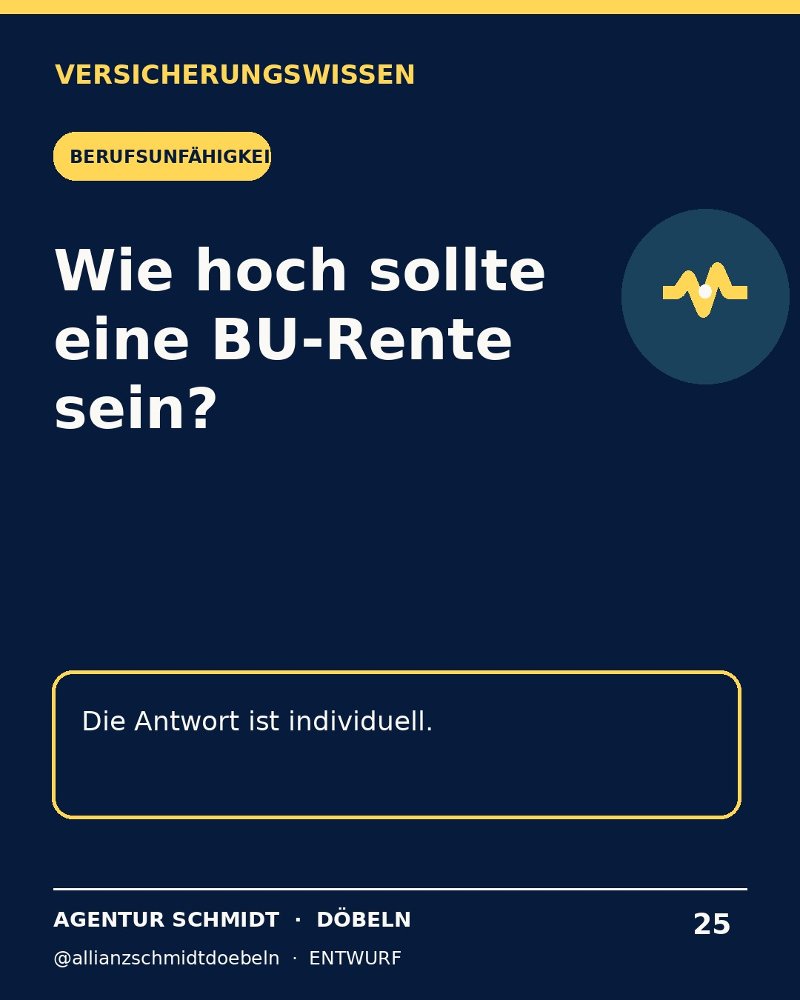

**Instagram-Bild:** Wie hoch sollte eine BU-Rente sein?  
*Die Antwort ist individuell.*

**Vorgesehene Caption:**

> Wie hoch sollte eine BU-Rente sein?
>
> Die passende Berufsunfähigkeitsrente orientiert sich unter anderem an laufenden Kosten und möglichen anderen Leistungen. Ein pauschaler Betrag passt selten zu allen.
>
> 💬 Hast du eine monatliche Zielsumme?
>
> Allgemeine Information, keine individuelle Leistungszusage. Maßgeblich sind Vertrag und Bedingungen.
>
> #Versicherung #Döbeln #Mittelsachsen #Versicherungswissen

[Zur Übersicht](#übersicht)

---

## Beitrag 26

**Thema:** Fahranfänger · **Status:** Entwurf / nicht freigegeben

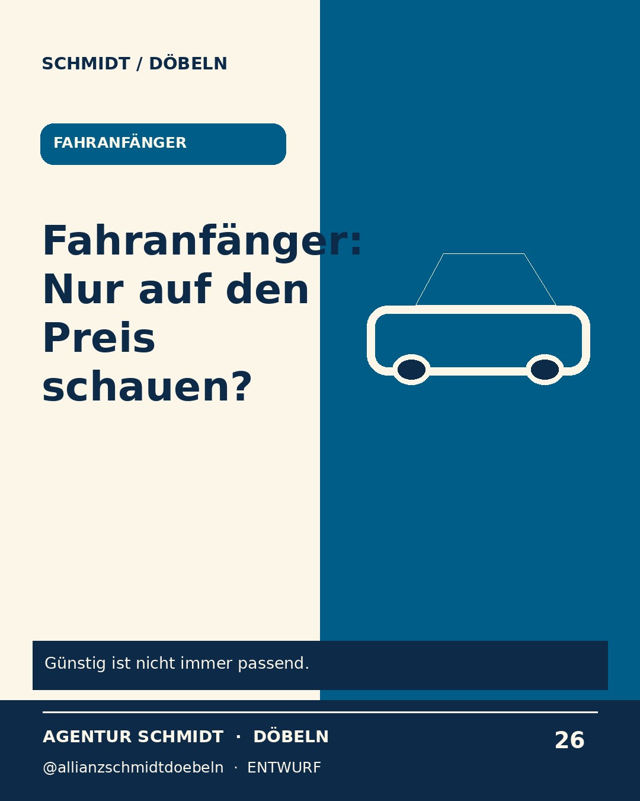

**Instagram-Bild:** Fahranfänger: Nur auf den Preis schauen?  
*Günstig ist nicht immer passend.*

**Vorgesehene Caption:**

> Fahranfänger: Nur auf den Preis schauen?
>
> Neben dem Beitrag zählen bei der Kfz-Versicherung Deckungsumfang, Selbstbeteiligung und vereinbarte Zusatzleistungen.
>
> 💬 Was wäre dir beim ersten Auto am wichtigsten?
>
> Allgemeine Information, keine individuelle Leistungszusage. Maßgeblich sind Vertrag und Bedingungen.
>
> #Versicherung #Döbeln #Mittelsachsen #Versicherungswissen

[Zur Übersicht](#übersicht)

---

## Beitrag 27

**Thema:** Wohngebäude · **Status:** Entwurf / nicht freigegeben

**Instagram-Bild:** Umbau geplant? Sag deiner Versicherung Bescheid.  
*Veränderungen können wichtig sein.*

**Vorgesehene Caption:**

> Umbau geplant? Sag deiner Versicherung Bescheid.
>
> Größere Umbauten oder Nutzungsänderungen können Einfluss auf den Versicherungsschutz haben. Melde solche Vorhaben frühzeitig und kläre den Handlungsbedarf.
>
> 💬 Planst du gerade eine Modernisierung?
>
> Allgemeine Information, keine individuelle Leistungszusage. Maßgeblich sind Vertrag und Bedingungen.
>
> #Versicherung #Döbeln #Mittelsachsen #Versicherungswissen

[Zur Übersicht](#übersicht)

---

## Beitrag 28

**Thema:** Zahnzusatz · **Status:** Entwurf / nicht freigegeben

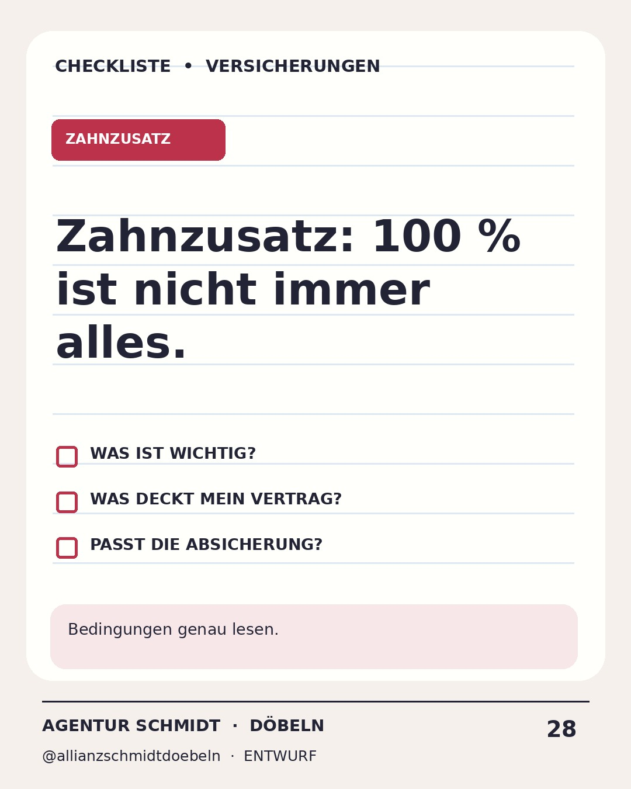

**Instagram-Bild:** Zahnzusatz: 100 % ist nicht immer alles.  
*Bedingungen genau lesen.*

**Vorgesehene Caption:**

> Zahnzusatz: 100 % ist nicht immer alles.
>
> Prozentangaben zur Erstattung beziehen sich auf bestimmte Leistungen und Berechnungsgrundlagen. Grenzen und Leistungsstaffeln können zusätzlich gelten.
>
> 💬 Vergleichst du Tarife auch nach den Bedingungen?
>
> Allgemeine Information, keine individuelle Leistungszusage. Maßgeblich sind Vertrag und Bedingungen.
>
> #Versicherung #Döbeln #Mittelsachsen #Versicherungswissen

[Zur Übersicht](#übersicht)

---

## Beitrag 29

**Thema:** Familie · **Status:** Entwurf / nicht freigegeben

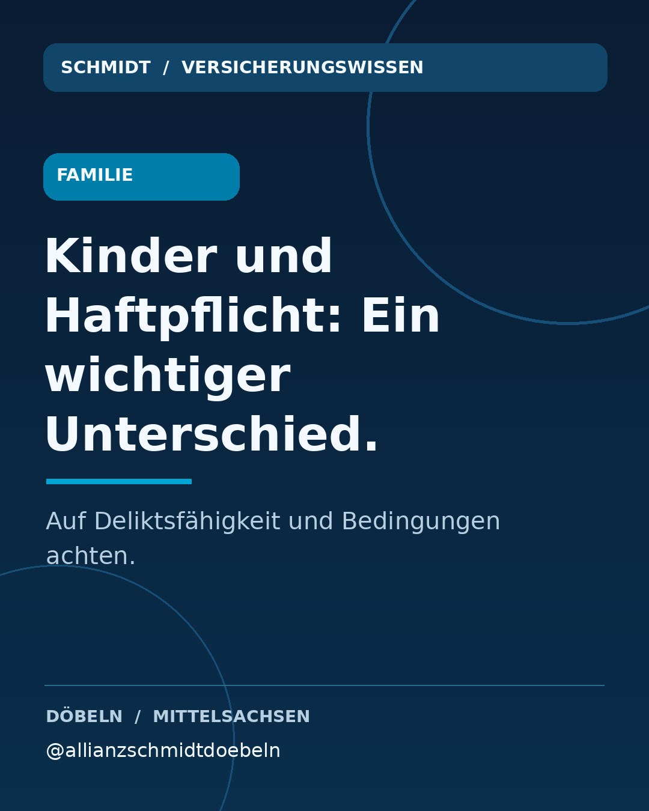

**Instagram-Bild:** Kinder und Haftpflicht: Ein wichtiger Unterschied.  
*Auf Deliktsfähigkeit und Bedingungen achten.*

**Vorgesehene Caption:**

> Kinder und Haftpflicht: Ein wichtiger Unterschied.
>
> Bei Schäden durch Kinder kommt es unter anderem auf das Alter, die Haftungsvoraussetzungen und den vertraglichen Schutz an. Manche Policen haben besondere Regelungen.
>
> 💬 Weißt du, was dein Familientarif vorsieht?
>
> Allgemeine Information, keine individuelle Leistungszusage. Maßgeblich sind Vertrag und Bedingungen.
>
> #Versicherung #Döbeln #Mittelsachsen #Versicherungswissen

[Zur Übersicht](#übersicht)

---

## Beitrag 30

**Thema:** Versicherungscheck · **Status:** Entwurf / nicht freigegeben

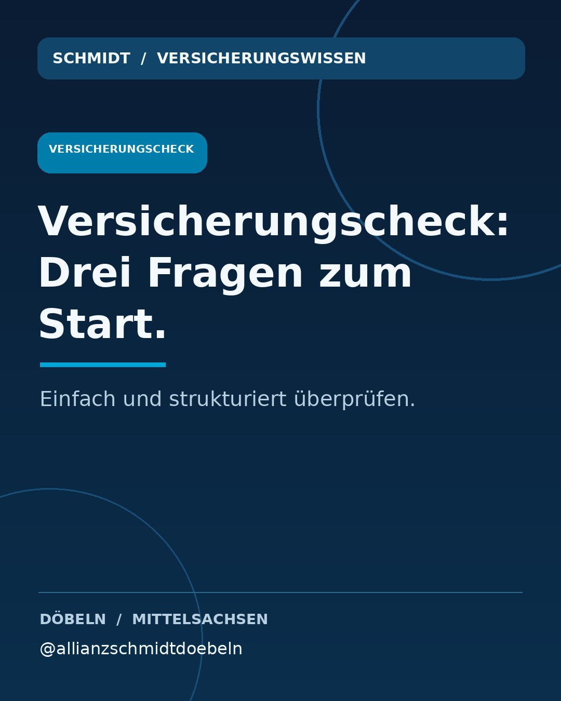

**Instagram-Bild:** Versicherungscheck: Drei Fragen zum Start.  
*Einfach und strukturiert überprüfen.*

**Vorgesehene Caption:**

> Versicherungscheck: Drei Fragen zum Start.
>
> Was hat sich in deinem Leben verändert? Welche Risiken wären finanziell schwer zu tragen? Wo bestehen unklare Leistungen oder doppelte Absicherungen? Ein gemeinsamer Blick hilft beim Sortieren.
>
> 💬 Welche dieser Fragen beschäftigt dich aktuell?
>
> Allgemeine Information, keine individuelle Leistungszusage. Maßgeblich sind Vertrag und Bedingungen.
>
> #Versicherung #Döbeln #Mittelsachsen #Versicherungswissen

[Zur Übersicht](#übersicht)

---
