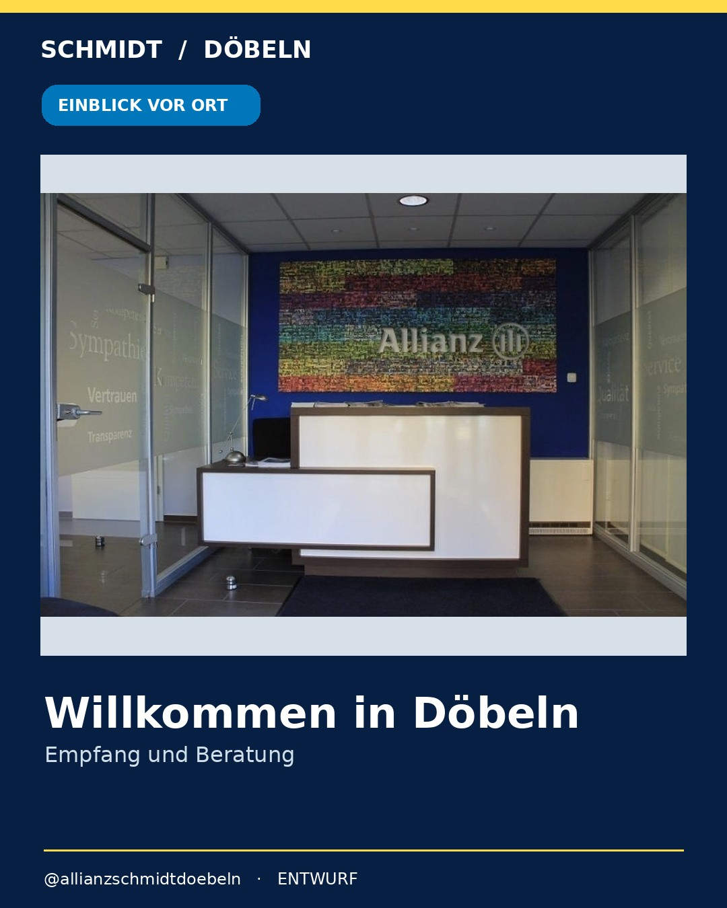

# Authentische Bilder der Allianz-Agentur Schmidt Döbeln

**Quellen:** [Offizielle Allianz-Agenturseite](https://vertretung.allianz.de/ralf.schmidt2/) und [Döbelner Firmenverzeichnis](https://mein-doebeln.de/firma/Versicherung)  
**Status:** Vorschauentwürfe, **nicht** zur Veröffentlichung freigegeben.

## 1. Bereits technisch verarbeitet: Empfangsbereich

Das öffentlich zugängliche Agenturfoto zeigt den Empfang mit der Allianz-Wand. **Dieser Entwurf kann nach Klärung der Bildrechte und der Agenturwerbevorgaben weiterentwickelt werden.** Quelle: Stadtmarketing Döbeln, `B-ro_2.jpg`.

## 2. Auf der Website gefundene Portraitquellen (nicht automatisch abrufbar)

Auf der offiziellen Website werden folgende Ansprechpartner mit jeweils einem Porträtbild gezeigt:

- Ralf Schmidt – Agenturinhaber
- Anja Sonnenberg – Kundenberaterin
- Kerstin Zimmermann – Büroleiterin
- Paul Schmidt – Kundenberater
- Simone Schmidt – Büroangestellte

Die Quell-URLs sind in [website_media.json](website_media.json) dokumentiert. Der technische Direktabruf liefert derzeit für alle fünf Allianz-Porträts **HTTP 403 Forbidden**. Deshalb wurden diese Bilder **nicht kopiert, nicht ersetzt und nicht öffentlich veröffentlicht**.

**Praktische Alternative:** Die Agentur kann die bereits vorhandenen Originaldateien aus ihrer Website-Mediathek oder dem eigenen Bildarchiv bereitstellen. Ein freigegebener Datei-Upload ist deutlich zuverlässiger als Web-Hotlinking. Für Mitarbeiterfotos ist die Einwilligung zur Nutzung in Social Media erforderlich.

## 3. Konkrete Posts mit Agenturmaterial

1. **Willkommen bei Allianz Schmidt Döbeln** – Empfangsfoto + authentischer Einblick, Kontaktmöglichkeit über Profil.
2. **Das Team kennenlernen** – echte Porträts, korrekte Namen und Funktionen, kein KI-generiertes Team.
3. **Einblicke in die Beratung** – echte Agenturräume, kein nachgestellter Kundenkontakt.
4. **Döbeln und Region** – belegte lokale Aktivitäten, z. B. der auf der Agenturseite erwähnte Eisfußball-Erfolg, nur mit autorisierten Bildern.
5. **Versicherungswissen mit echten Ansprechpartnern** – Karussells mit fachlichen Infos und freigegebenen Teamfotos.

## Veröffentlichungsschutz

Alle Beiträge und Medien verbleiben Entwürfe. Die vorhandenen 30 früheren Posts in `posts.json` stehen auf `approved:false`; außerdem ist die Veröffentlichung in GitHub nur nach expliziter Agenturfreigabe und Aktivierung möglich. Vor Nutzung der Teamfotos müssen Bild-/Persönlichkeitsrechte und Allianz-Werberichtlinien geklärt werden.
